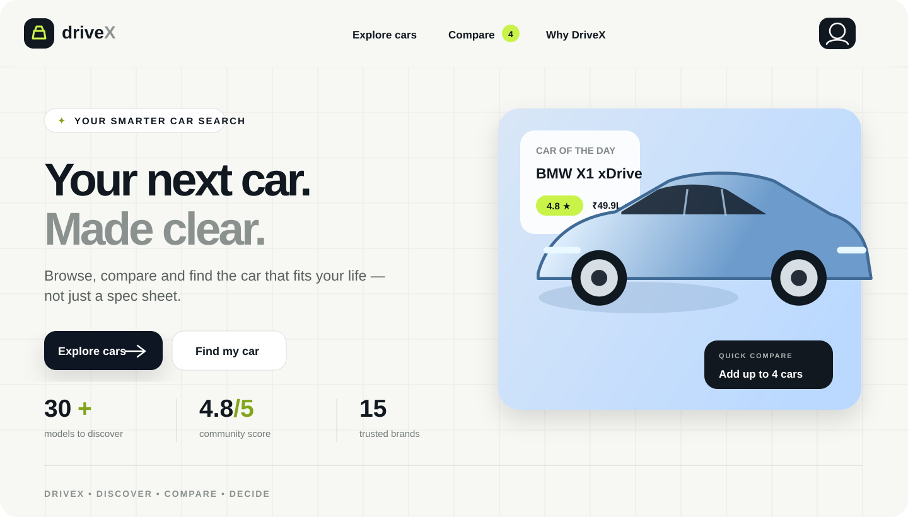

<div align="center">

# DriveX

### Find the drive that fits your life.

*A modern, full-stack vehicle discovery platform for browsing, filtering, saving and comparing cars with confidence.*

[](https://react.dev/)
[](https://nodejs.org/)
[](https://expressjs.com/)
[](https://tailwindcss.com/)

<br />



</div>

## Why DriveX?

Buying a car should feel exciting, not overwhelming. DriveX turns a sea of specifications into a clean, visual and easy-to-compare experience. Search by make or model, narrow the list by budget and body type, save your favourites, then place up to four cars side-by-side.

| Discover | Compare | Decide |
| :--- | :--- | :--- |
| Browse a hand-picked catalogue across 15 popular brands. | Put up to four cars next to each other and see the differences. | Save promising cars to a shortlist and come back when you are ready. |

## Highlights

- **30 carefully selected models** across Maruti Suzuki, Hyundai, Tata, Mahindra, Kia, Toyota, Honda, Skoda, Volkswagen, MG, BMW, Mercedes-Benz, Audi, Renault and Nissan.
- **Search and filter** by make, model, body style and maximum budget.
- **Vehicle detail pages** with a real-photo gallery, key features, pricing, ratings and specification cards.
- **Smart comparison** drawer and a side-by-side comparison modal for up to four cars.
- **Favourites shortlist** that stays in the session while you browse.
- **JWT authentication** with bcrypt password hashing and HTTP-only cookie sessions.
- **Contact endpoint** ready for Nodemailer when email credentials are configured.

## Tech stack

| Layer | Tools |
| --- | --- |
| Frontend | React, Vite, Tailwind CSS, Lucide icons |
| Backend | Node.js, Express.js |
| Authentication | JWT, bcryptjs, cookie-parser |
| Email | Nodemailer |
| Data | Lightweight in-memory catalogue for a simple, beginner-friendly setup |

## Project structure

```text
DriveX/
├── frontend/              # React + Vite interface
│   └── src/
│       ├── components/    # Cards, details, comparison UI
│       └── data/          # 30-car catalogue and image data
├── backend/               # Express API and auth routes
│   └── src/
│       ├── data/
│       └── middleware/
├── docs/                  # README visuals
└── README.md
```

## Run locally

You will need **Node.js 18+**. Open two terminals from the project root.

```bash
# Terminal 1 — API
cd backend
copy .env.example .env
npm install
npm run dev
```

```bash
# Terminal 2 — client
cd frontend
npm install
npm run dev
```

Then visit **http://localhost:5173**. The API starts at **http://localhost:5001**.

## API at a glance

| Method | Route | What it does |
| --- | --- | --- |
| `GET` | `/api/cars` | Lists the vehicle catalogue and accepts search/filter parameters. |
| `GET` | `/api/cars/:id` | Returns one vehicle by its ID. |
| `POST` | `/api/auth/register` | Creates an account and starts a session. |
| `POST` | `/api/auth/login` | Signs a user in with a secure HTTP-only cookie. |
| `POST` | `/api/auth/logout` | Ends the active session. |
| `POST` | `/api/contact` | Accepts a contact request; can send email via Nodemailer. |

## Environment variables

Create `backend/.env` from `.env.example`. The application works with its default local values; add SMTP values only when you want contact emails to be delivered.

```env
PORT=5001
CLIENT_URL=http://localhost:5173
JWT_SECRET=replace-this-with-a-long-random-secret
```

---

<div align="center">

Built with care for better car decisions. If DriveX helped you, consider starring the repository. ★

</div>
